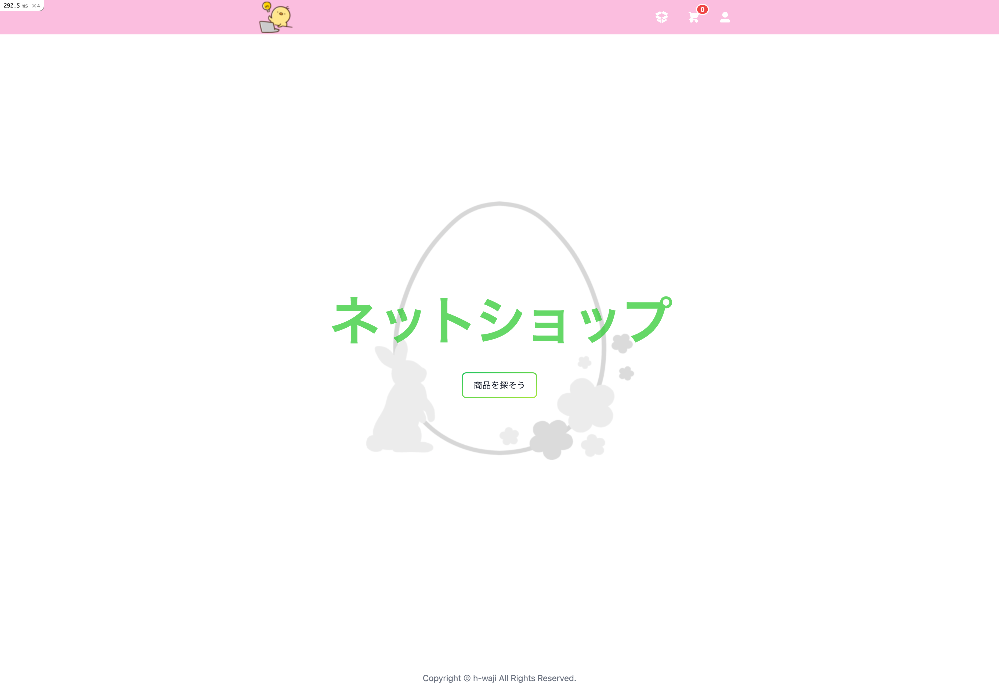
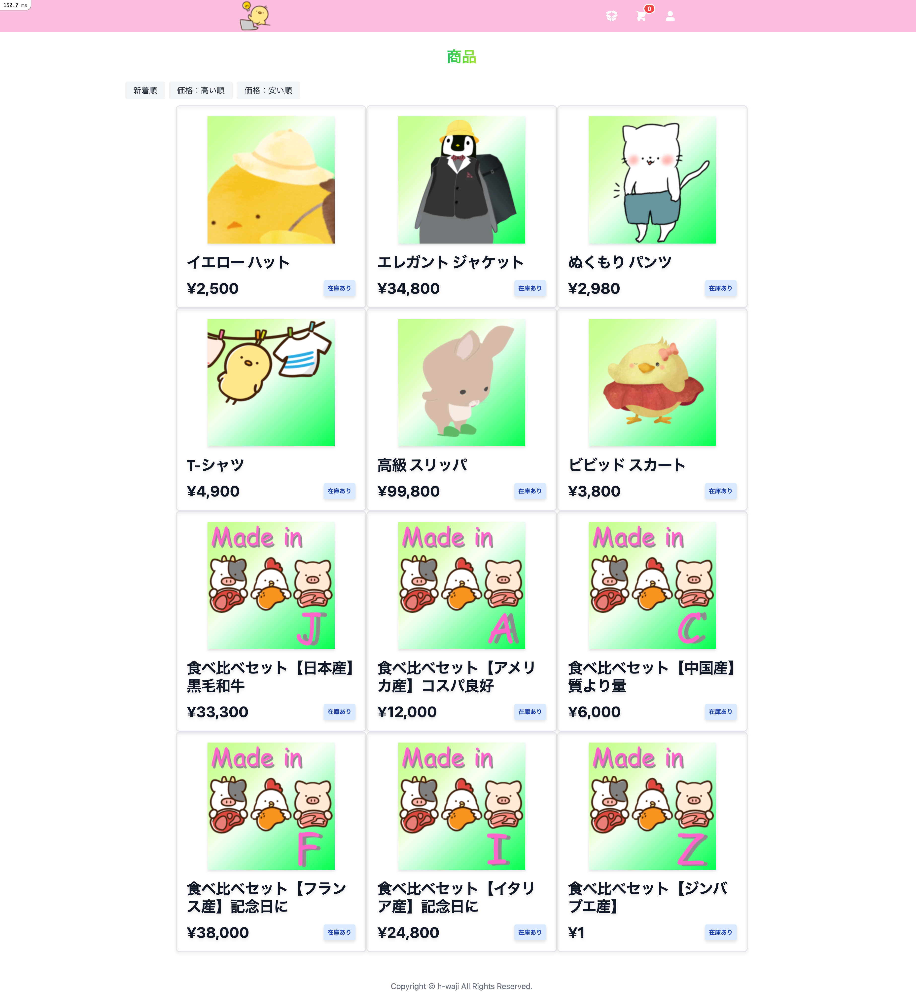

# EC Site Legacy

過去に制作した EC サイトのポートフォリオ作品です。

商品一覧、会員登録、決済機能など、EC サイトの基本機能を実装しています。

## Screenshots

### Top Page

### Products

## Tech Stack

| Category | Technology |
|---------|---------|
| Backend | Ruby 3.2, Rails 7 |
| Database | PostgreSQL, Redis |
| Infrastructure | Docker |
| Authentication | Devise |
| Payment | Stripe |
| Frontend | Tailwind CSS, Bootstrap |
| Design Tool | Krita |

## Development Environment

本プロジェクトは、Rails + Docker のサンプルアプリを参考に開発しています。

- https://github.com/nickjj/docker-rails-example

Docker を用いた Rails アプリケーションの開発環境を参考にし、EC サイトとして機能を追加・カスタマイズしています。

## Features

- 商品一覧機能
- 会員登録機能
- Stripe を利用した決済機能の実装
- Redis / Sidekiq を利用したバックグラウンド処理

## Assets

本プロジェクトの商品画像の一部には、以下の素材サイトを利用しています。

- ACイラスト

## License

このリポジトリはポートフォリオ目的で公開しています。

著作権は作者に帰属します。
無断転載・再配布・商用利用はご遠慮ください。

This repository is published for portfolio purposes only.

All rights to the content belong to the author.

Please do not reproduce, redistribute, or use any part of this project for commercial purposes without permission.

## Author

- h-waji (hamltail)
